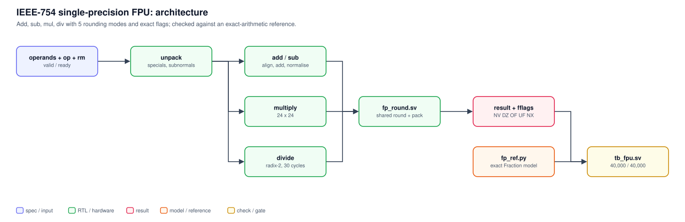
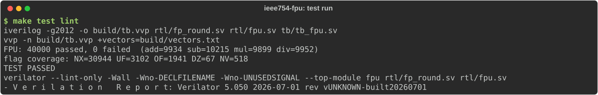

# IEEE-754 single-precision FPU

[](https://github.com/Ana2601/ieee754-fpu/actions/workflows/ci.yml)

Add, subtract, multiply and divide for binary32, with all five RISC-V rounding modes, full special-value handling and exact exception flags.



## Features

- Rounding: RNE, RTZ, RDN, RUP, RMM
- Subnormal operands **and** results (gradual underflow), with tininess detected after rounding
- NaN (quiet/signalling, canonical NaN out), ±∞, signed zeros
- Flags in RISC-V `fflags` order `{NV, DZ, OF, UF, NX}`
- valid/ready interface; add/sub/mul take 3 cycles, divide takes 30 (radix-2 restoring divider)

`rtl/fp_round.sv` is a shared round-and-pack stage, so all four operations round identically.

## Verification: the reference model shares no code with the RTL

`scripts/fp_ref.py` computes every result **exactly** with Python `fractions.Fraction` and rounds straight from the definition in the standard. There are no guard/round/sticky bits and no alignment shifter, so it cannot repeat an RTL bug. The model itself is cross-checked first against the host CPU's IEEE hardware (numpy float32, RNE) on 20,000 operations.

The constrained-random generator targets the hard cases: specials, subnormals, tiny and huge exponents, near-cancellation (operands a few ulps apart), sparse significands (exact results and rounding ties), and mid-range exponents for every alignment distance.

## Results (measured)

| Check | Result |
|---|---|
| Reference model vs. numpy float32 | 20,000 / 20,000 agree |
| RTL vs. reference (result **and** all 5 flags) | **40,000 / 40,000 pass** |
| Operation mix | add 9,934 · sub 10,215 · mul 9,899 · div 9,952 |
| Flag coverage | NX 30,944 · UF 3,102 · OF 1,941 · DZ 67 · NV 518 |
| Lint | Verilator `-Wall` clean |

## Run

```bash
make test            # 40k vectors (N=... to change)
make lint
make synth
```

## Test run

Output of the CI command (`make test lint`), captured from a local run:



## Limitations / next steps

No fused multiply-add, square root or conversions. The divider is iterative (30 cycles). An SRT radix-4 divider would halve that.

## Setup

- [OSS CAD Suite](https://github.com/YosysHQ/oss-cad-suite-build) (Icarus Verilog, Verilator, Yosys)
- Python packages: `pip install -r requirements.txt`

```bash
make test
make lint
```

The same commands run in CI on every push (`.github/workflows/ci.yml`).
